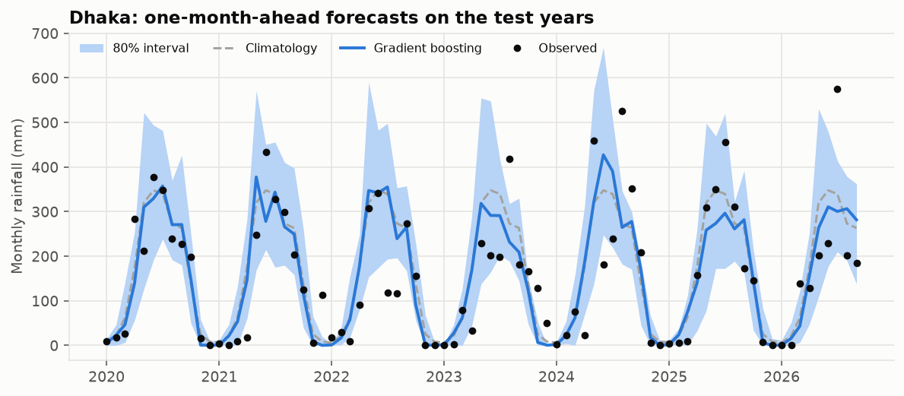

# climate-risk-bd: Bangladesh rainfall and drought outlook

One-month-ahead **rainfall-anomaly** and **drought-risk** forecasts for Bangladesh divisional cities, built on 45 years of ERA5 reanalysis. The project includes a reproducible pipeline, honest baselines, uncertainty estimates, a FastAPI service and a Streamlit dashboard.



## What I found

1. **The obvious dataset was broken, so I checked before modelling.** NASA POWER's corrected precipitation reads 37–64% of ERA5 before 1997 and 107–231% after 2016, in every city. Dhaka goes from about 1,000 mm/yr in the 1990s to 4,600 mm in 2017. A model trained on it showed a "35% skill gain" that was really the model learning the data error. I switched to ERA5. ([check](reports/data_source_check.md))

   

2. **Next month's rainfall amount is not predictable from local history.** On the 2020–2026 test years, neither ridge regression nor gradient boosting beats "assume a normal month". Ridge's MAE skill is +0.6% with a 95% CI of −2.5% to +3.9%. That is the expected scientific result: skill at this lead time comes from large-scale climate drivers and dynamical models, not lagged local rainfall.

3. **Drought risk is predictable, and a simple physics-based baseline matches ML.** P(SPI-3 ≤ −1 next month) reaches ROC-AUC about 0.91 and a Brier skill of +39% over the base rate. But two of SPI-3's three months are already known, and a **climatological ensemble** captures that: known rain plus every historical value of next month. Logistic regression and gradient boosting do not improve on it (−2% to −3% Brier). Without that baseline, the ML models would look much better than they are.

4. **Intervals are close but slightly overconfident.** The 80% conformal intervals cover 76.7% of test months, and only 71% in the monsoon, because recent monsoons were more extreme than the 2016–2019 calibration years.

Full numbers: [`reports/evaluation.md`](reports/evaluation.md) · EDA: [`reports/eda.md`](reports/eda.md) · Limitations: [`MODEL_CARD.md`](MODEL_CARD.md)

## The task

Standing at the end of month *t*, predict for month *t+1* in each city:

| Target | Definition |
|---|---|
| Rainfall anomaly (regression) | Monthly total minus the 1981–2015 mean for that city and calendar month. Modelled as a standardized anomaly, scored in mm |
| Drought (classification) | SPI-3 ≤ −1.0, the WMO "moderately dry or worse" threshold, about 16% of months by construction |

**Data:** ERA5 daily reanalysis via the [Open-Meteo archive](https://open-meteo.com/en/docs/historical-weather-api) (no API key), with rainfall, temperature, humidity and wind from 1981 onward. Data is aggregated to complete calendar months.

**Locations:** Dhaka, Chattogram, Khulna, Rajshahi, Sylhet, Barishal and Rangpur. Mymensingh is configured but missing from the current run because the download hit Open-Meteo's hourly rate limit; rerun `python -m climrisk all` to add it.

## Method

```
ingest ─► clean ─► features ─► EDA
                      │
                      ▼
      train (selected on 2016–2019) ─► evaluate (2020+, once) ─► API / dashboard
```

| Step | Details |
|---|---|
| Cleaning | Range checks, duplicate removal, complete monthly calendar, trimming of the unfinished current month. Short covariate gaps are interpolated; rainfall is never invented |
| Features (19) | Standardized anomalies (current, lags 1/2/11, 3- and 6-month means), SPI-1/3/6/12, temperature and humidity anomalies, wind, target-month seasonality, next month's climatology, coordinates, and the ensemble drought probability |
| Split | By time: train 1982–2015 · validation 2016–2019 · test 2020 onward. Climatology and SPI are fitted on training years only |
| Rainfall models | Climatology baseline → ridge regression → gradient boosting (`HistGradientBoostingRegressor`) |
| Drought models | Base rate → climatological ensemble → logistic regression → gradient boosting |
| Uncertainty | Conformalized quantile regression (80% intervals) and year-block bootstrap CIs on skill scores |
| Error analysis | By season and city, the ten largest misses (mostly record floods in Sylhet and Chattogram), a reliability diagram and permutation importance |

### Leakage guards (tested)

- Features at month *t* are unchanged when any data after *t* is altered, for every row after the reference period.
- Climatology ignores post-reference years.
- SPI fitted on the reference period is unaffected by later data.
- The split is ordered and disjoint, and targets never cross between cities.

## Quick start

```bash
python -m venv .venv
```
```bash
.venv/Scripts/activate        # Windows
```
```bash
source .venv/bin/activate     # macOS/Linux
```
```bash
pip install -e ".[dashboard,dev]"
```
```bash
python -m climrisk all        # download → clean → features → EDA → train → evaluate (~1 min with cached data)
```
```bash
pytest
```

Each step can also run alone: `python -m climrisk ingest | features | eda | train | evaluate`. The processed data is committed, so `train` and `evaluate` work without downloading anything.

### API

```bash
uvicorn climrisk.api:app --reload
```

Interactive docs are at http://127.0.0.1:8000/docs.

| Endpoint | Returns |
|---|---|
| `GET /predict?city=Dhaka&month=2026-10` | Expected rainfall, 80% range, normal, drought probability vs usual rate, risk level, and the observed outcome if known |
| `GET /forecast/latest` | The newest unobserved month for every city |
| `GET /history?city=Sylhet&start=2020-01` | Monthly rainfall, normal, anomaly and SPI-3 |
| `GET /cities`, `/metrics`, `/health` | Metadata and test metrics |

### Dashboard

```bash
streamlit run app/dashboard.py
```

## Project layout

```
src/climrisk/   config · ingest · clean · spi · features · train · evaluate · eda · predict · api · cli
app/            Streamlit dashboard
tests/          35 offline tests on synthetic data (ingest, cleaning, SPI, leakage, models, API)
scripts/        check_power_homogeneity.py (the data-source audit)
data/processed/ cleaned monthly data and features (committed; raw downloads are cached, not committed)
reports/        generated EDA, evaluation, metrics.json and figures
```

## Limitations

ERA5 is reanalysis, not gauge data, and a single grid point stands in for a whole division. Extremes are under-predicted. The test set covers only about 7 years. Climatology is fixed to 1981–2015. Sylhet's significant drying trend in ERA5 (−222 mm/decade) should be checked against gauges before anyone trusts it. **This is a portfolio demo, not an operational forecast.** Use [BMD](https://live6.bmd.gov.bd/) and [FFWC](http://www.ffwc.gov.bd/) for real decisions. More detail is in [`MODEL_CARD.md`](MODEL_CARD.md).

## Next steps

- Add ENSO (ONI) and Indian Ocean Dipole indices, the most plausible source of real one-month rainfall skill.
- Benchmark against ECMWF SEAS5 seasonal forecasts.
- Compare with BMD station gauges.
- Store forecasts in PostgreSQL for live verification over time.

## License

MIT
