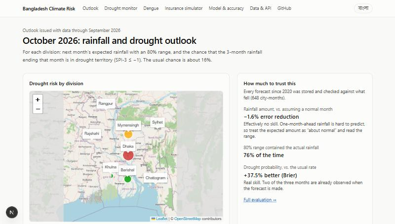
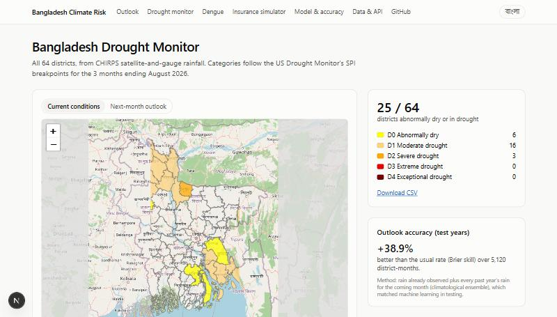
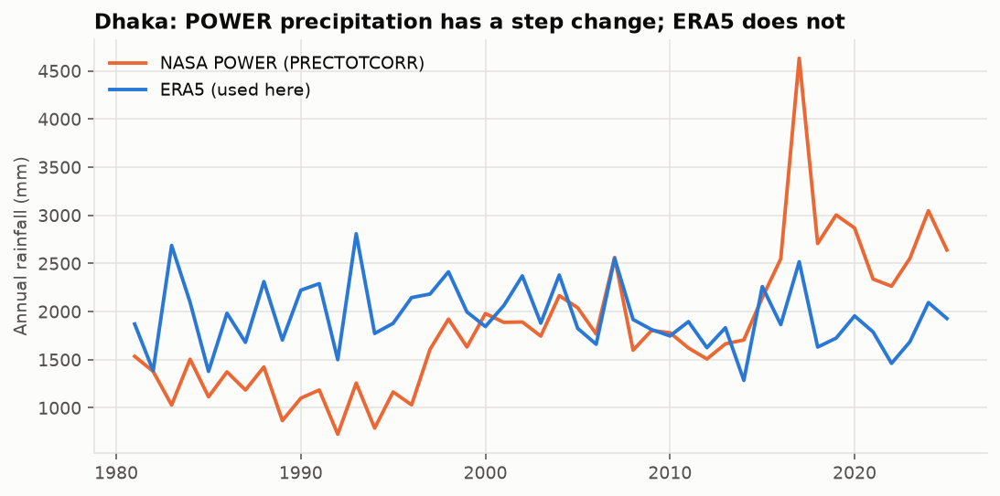

# climate-risk-bd: Bangladesh climate risk outlook

A full-stack climate-risk app for Bangladesh. It covers:

- one-month-ahead **rainfall**, **drought** and **heat-wave** outlooks for the 8 divisions;
- a **64-district Drought Monitor**;
- a **dengue** forecasting backtest;
- a **drought index-insurance simulator**.

It stores every forecast and publishes how each one compared with what actually happened. The site is available in English and বাংলা.

- **ML pipeline (Python):** data audits, cleaning, SPI, leakage-safe features, honest baselines, uncertainty, error analysis and controlled experiments (ENSO/IOD indices, LSTM).
- **Backend:** FastAPI on PostgreSQL, serving forecasts, a frozen forecast log, explanations, verification, CSV exports and an RSS alerts feed.
- **Frontend:** Next.js 16 with an outlook map, division pages, a district choropleth, dengue and insurance pages, a model page and a Bangla toggle.
- **Ops:** Docker Compose, a Render + Neon + Vercel deployment and a monthly data-refresh workflow.





## What this project does, in plain words

Bangladesh's farming, water supply and flood planning all depend on rain, and most of it falls in a few monsoon months. A dry spell at the wrong time can ruin a rice crop. This project answers two questions for each division, one month ahead:

1. **How much rain is likely next month?** Each forecast is a best guess plus a range, compared with what is normal for that month.
2. **What is the chance that next month tips into drought?** The answer is a probability, shown next to the usual chance.

It then **checks its own work**. Every forecast it would have made since 2016 is stored next to the rain that actually fell, so anyone can see how often it was right. New live forecasts are also frozen the moment they are published, so the record can't be quietly rewritten later.

It also offers:

- **Drought Monitor for all 64 districts:** a monthly map in the style of the US Drought Monitor (categories D0 to D4), built from CHIRPS satellite-and-gauge rainfall, with next month's drought odds.
- **Heat-wave outlook:** expected days at or above 36 °C, the Bangladesh Meteorological Department's heat-wave threshold.
- **Dengue:** a test of whether next month's cases by division can be forecast (2020–2025 data).
- **Index-insurance simulator:** pick a district, a rice season and a payout rule, and see which years since 1981 would have paid.

### How it works, step by step

| Step | What happens | Where in the code |
|---|---|---|
| 1. Collect | Downloads 45 years (1981 to now) of daily rain, temperature, humidity and wind for each division from ERA5, a global weather record built by the European weather centre ECMWF. Free, via Open-Meteo | `src/climrisk/ingest.py` |
| 2. Check the data | Compares sources before trusting any. NASA's POWER dataset, the obvious first choice, turned out to change its rainfall levels over time, so it was rejected (see "What I found") | `scripts/check_power_homogeneity.py` |
| 3. Clean | Adds daily values up into monthly totals, removes impossible values, makes sure no month is missing, and drops the current unfinished month | `src/climrisk/clean.py` |
| 4. Describe "normal" | For every division and calendar month, works out the 1981–2015 average rainfall, and a drought index (SPI) that says how unusually dry or wet a period is | `src/climrisk/spi.py`, `features.py` |
| 5. Build clues | For each month, collects what was known at the end of it: how wet the last few months were, current drought index, temperature, humidity and season | `src/climrisk/features.py` |
| 6. Train and compare | Fits simple baselines (e.g. "assume a normal month") and machine-learning models on 1982–2015, tunes them on 2016–2019 and tests them once on 2020 onward | `src/climrisk/train.py`, `evaluate.py` |
| 7. Publish | Saves every forecast, the observed outcomes and the accuracy scores into a PostgreSQL database | `src/climrisk/sync.py`, `db.py` |
| 8. Serve | A FastAPI web service answers questions like "forecast for Dhaka, October 2026" from the database | `src/climrisk/api.py` |
| 9. Show | A Next.js website draws the map, forecast cards, charts and track record | `web/` |
| 10. Repeat | Once a month an automated job downloads the newest month, rebuilds and republishes, so the site moves forward on its own | `.github/workflows/refresh.yml` |

Alongside the city model, `districts.py` builds the 64-district monitor from CHIRPS, `validation.py` checks ERA5 against CHIRPS, `heat.py` and `dengue.py` add the heat and dengue models, `explain.py` explains each drought forecast, and `experiments.py` and `lstm.py` run the controlled experiments.

### How to read a forecast

Example from the live site, **Dhaka, October 2026**:

> Expected rainfall **88 mm** (normal is 138 mm). 80% range **43–191 mm**. Drought probability **55%** (usually 16%): **High** risk.

- **Expected rainfall** is the single best guess. Treat it loosely, because the evaluation shows rainfall amounts a month ahead are hard to predict.
- **80% range:** in 8 out of 10 months the real total should land inside it. This is the number to plan with.
- **Normal:** the 1981–2015 average for that month, for comparison.
- **Drought probability:** the chance that the 3 months ending next month are among the driest ~16% on record for that time of year. "Usually 16%" is the background rate. 55% means drought is more than three times as likely as usual. The site's "Why this drought risk?" panel shows that almost all of it comes from rain already observed: a dry September, with a very wet July about to leave the 3-month window.
- **Risk level:** *Low*, *Elevated* (≥1.5× the usual chance) or *High* (≥2.5× and at least 50%).

### Key terms

| Term | Meaning |
|---|---|
| **Anomaly** | How far a month's rainfall is from normal, e.g. "−34 mm vs normal" |
| **SPI-3** | Standardized Precipitation Index over 3 months. 0 = typical; −1 or below = drought (roughly the driest 16%); +1 or above = wet |
| **Reanalysis (ERA5)** | A gap-free reconstruction of past weather that blends observations with a weather model. Consistent, but not a rain gauge |
| **Baseline** | The simplest reasonable forecast, used to judge whether a model adds anything. A model that can't beat it isn't useful |
| **Skill** | How much a model reduces error compared with a baseline. 0% = no better; negative = worse |
| **Hindcast** | A forecast made for a past month using only the data available before it, so it can be checked fairly |
| **Brier score** | Accuracy of probability forecasts (lower is better) |

## What I found

1. **The obvious dataset was broken, so I checked before modelling.** NASA POWER's corrected precipitation reads 37–64% of ERA5 before 1997 and 107–231% after 2016, in every city. Dhaka goes from about 1,000 mm/yr in the 1990s to 4,600 mm in 2017. A model trained on it showed a "35% skill gain" that was really the model learning the data error. I switched to ERA5. ([check](reports/data_source_check.md))

   

2. **Next month's rainfall amount is barely predictable from local history.** On the 2020–2026 test years, neither ridge regression nor gradient boosting beats "assume a normal month". Ridge's MAE skill is +0.3% with a 95% CI of −2.9% to +3.9%. That is the expected scientific result: skill at this lead time comes from large-scale climate drivers and dynamical models, not lagged local rainfall.

3. **Drought risk is predictable, and a simple physics-based baseline matches ML.** P(SPI-3 ≤ −1 next month) reaches ROC-AUC about 0.90 and a Brier skill of +38% over the base rate. But two of SPI-3's three months are already known, and a **climatological ensemble** captures that: known rain plus every historical value of next month. Logistic regression and gradient boosting do not improve on it (−0.4% to −4% Brier). Without that baseline, the ML models would look much better than they are.

4. **Intervals are close but slightly overconfident.** The 80% conformal intervals cover 75.9% of test months, and only about 71–72% in the pre-monsoon and monsoon seasons, because recent seasons were more extreme than the 2016–2019 calibration years.

5. **Global climate drivers might help, but the rules say "not yet".** Adding ENSO and Indian Ocean Dipole indices (each lagged to when it is actually published) made no difference on the validation years, so they stay off. On the 2020–2026 test years the same model shows **+7.1% rainfall skill (95% CI +4.1% to +10.2%)**. Switching it on because of that would tune the model to the test set, so I report it instead ([experiment](reports/experiment_climate_indices.md)).

6. **An LSTM finds a small, consistent rainfall gain.** Across 5 random seeds it gets **+4.9% to +6.0%** rainfall skill, but it is no better than the ensemble for drought ([experiment](reports/experiment_lstm.md)). It isn't deployed, because seeds measure training noise, not year-to-year luck.

7. **ERA5 agrees with gauge-blended rainfall, but only moderately on drought months.** Against CHIRPS (satellite + rain gauges), ERA5 totals are within 13% in every city and monthly anomalies correlate at 0.51–0.70. Drought-month agreement is only moderate (Cohen's κ 0.38–0.53), which is why the district monitor uses CHIRPS directly ([check](reports/data_validation_chirps.md)).

8. **The district drought outlook works.** Over 5,120 test district-months it is **38.9% better** than the usual rate (Brier skill).

9. **Heat and dengue follow the same pattern: simple baselines are hard to beat.**
   - **Heat-wave days:** the model is +4.6% better than the 1981–2015 normal but only +1.7% better than the last decade's average (CI includes zero). It missed Rajshahi's record April 2024, expecting 7 heat-wave days when 24 happened ([report](reports/heat_evaluation.md)).
   - **Dengue:** a seasonal growth ratio beats "same as this month" by 39.5%, and adding weather does not improve on it ([report](reports/dengue_evaluation.md)).

Full numbers: [`reports/evaluation.md`](reports/evaluation.md) · EDA: [`reports/eda.md`](reports/eda.md) · Limitations: [`MODEL_CARD.md`](MODEL_CARD.md)

## The task

Standing at the end of month *t*, predict for month *t+1* in each city:

| Target | Definition |
|---|---|
| Rainfall anomaly (regression) | Monthly total minus the 1981–2015 mean for that city and calendar month. Modelled as a standardized anomaly, scored in mm |
| Drought (classification) | SPI-3 ≤ −1.0, the WMO "moderately dry or worse" threshold, about 16% of months by construction |

**Data:** ERA5 daily reanalysis via the [Open-Meteo archive](https://open-meteo.com/en/docs/historical-weather-api) (no API key), with rainfall, temperature, humidity and wind from 1981 onward. Data is aggregated to complete calendar months.

**Locations:** the 8 divisional capitals (Dhaka, Chattogram, Khulna, Rajshahi, Sylhet, Barishal, Rangpur, Mymensingh) for the city models, and all 64 districts for the drought monitor.

## Method

```
ingest ─► clean ─► features ─► EDA
                      │
                      ▼
      train (selected on 2016–2019) ─► evaluate (2020+, once) ─► API / dashboard
```

| Step | Details |
|---|---|
| Cleaning | Range checks, duplicate removal, complete monthly calendar, trimming of the unfinished current month. Short covariate gaps are interpolated; rainfall is never invented |
| Features (19) | Standardized anomalies (current, lags 1/2/11, 3- and 6-month means), SPI-1/3/6/12, temperature and humidity anomalies, wind, target-month seasonality, next month's climatology, coordinates, and the ensemble drought probability |
| Split | By time: train 1982–2015 · validation 2016–2019 · test 2020 onward. Climatology and SPI are fitted on training years only |
| Rainfall models | Climatology baseline → ridge regression → gradient boosting (`HistGradientBoostingRegressor`) |
| Drought models | Base rate → climatological ensemble → logistic regression → gradient boosting |
| Uncertainty | Conformalized quantile regression (80% intervals) and year-block bootstrap CIs on skill scores |
| Error analysis | By season and city, the ten largest misses (mostly record floods in Sylhet and Chattogram), a reliability diagram and permutation importance |

### Leakage guards (tested)

- Features at month *t* are unchanged when any data after *t* is altered, for every row after the reference period.
- Climatology ignores post-reference years.
- SPI fitted on the reference period is unaffected by later data.
- The split is ordered and disjoint, and targets never cross between cities.

## Architecture

```
 Open-Meteo (ERA5)                     GitHub Actions, monthly: update → train → evaluate → commit
        │                                                    │ push triggers redeploy
        ▼                                                    ▼
 Python pipeline ── db-sync ──► PostgreSQL ◄── FastAPI (Render) ◄── Next.js server (Vercel) ◄── browser
 (src/climrisk)                 (Neon)         reads only            fetches on the server
```

The model runs offline. `db-sync` writes the observations, a stored forecast for every validation and test month (each with its outcome), the live forecast and the evaluation metrics. The API only reads, and the web app only talks to the API from its server, so no API URL or credentials reach the browser.

| Table | Contents |
|---|---|
| `cities` | name, latitude, longitude |
| `observations` | monthly rainfall, normal, anomaly, SPI-3, temperature, humidity |
| `forecasts` | per model version, city and month: expected rainfall, 80% range, normal, drought probability, risk level, split (`validation` / `test` / `live`) |
| `model_runs` | model version, data-through date, metadata, full test metrics; one is active |

## Run it locally

**1. Python pipeline** (Python 3.11 or newer)

```bash
python -m venv .venv
```
```bash
.venv/Scripts/activate
```
On macOS/Linux use `source .venv/bin/activate` instead.
```bash
pip install -e ".[dashboard,dev]"
```
```bash
python -m climrisk all
```
That runs download → clean → features → EDA → train → evaluate, about 1 minute with cached data.
```bash
pytest
```

The processed data is committed, so `train` and `evaluate` work offline. `python -m climrisk update` fetches only recent months, which is what the monthly job uses.

Other steps:

| Command | What it does |
|---|---|
| `python -m climrisk districts` | Downloads CHIRPS and the district boundaries, builds the 64-district monitor and the ERA5 check |
| `python -m climrisk heat` | Heat-wave outlook (also part of `all`) |
| `python -m climrisk dengue` | Dengue backtest |
| `python -m climrisk experiment` | ENSO/IOD with-vs-without comparison |
| `python -m climrisk experiment-lstm` | LSTM experiment; needs `pip install -e ".[experiments]"` |
| `python -m climrisk db-sync` | Publishes everything above to the database |

**2. PostgreSQL.** Any Postgres works; set `DATABASE_URL` (see `.env.example`). Without Docker, a throwaway local server with no password, on port 54330:

```bash
initdb -D .pgdata -U climrisk -A trust
```
```bash
pg_ctl -D .pgdata -o "-p 54330" -l .pgdata/server.log start
```
```bash
createdb -h localhost -p 54330 -U climrisk climrisk
```
```bash
python -m climrisk db-sync
```

**3. API**

```bash
uvicorn climrisk.api:app --reload
```

Interactive docs are at http://127.0.0.1:8000/docs.

| Endpoint | Returns |
|---|---|
| `GET /forecasts/latest` | The live forecast for every division (rainfall, drought, heat) |
| `GET /forecast?city=Dhaka&month=2024-08` | One stored forecast, with its observed outcome if known |
| `GET /forecasts?city=Sylhet&start=2022-01` | A city's forecast history with outcomes |
| `GET /verification?city=Dhaka` | Skill, interval coverage and drought Brier score computed from stored forecasts |
| `GET /history?city=Sylhet&start=2020-01` | Monthly rainfall, normal, anomaly, SPI-3 |
| `GET /issued?city=Dhaka` | Frozen forecast log: each live forecast exactly as first published |
| `GET /explain?city=Dhaka` | Top drivers of the live drought probability |
| `GET /districts`, `/districts/{name}`, `/districts/geojson`, `/districts/evaluation` | 64-district drought monitor |
| `GET /heat/evaluation`, `/dengue`, `/validation` | Heat outlook skill, dengue backtest, ERA5-vs-CHIRPS check |
| `GET /export/forecasts.csv`, `/export/districts.csv` | CSV downloads |
| `GET /alerts.rss` | RSS feed of drought, heat and district warnings |
| `GET /cities`, `/metrics`, `/health` | Locations, full test evaluation, status |

**4. Web app**

```bash
cd web
```
```bash
npm install
```
```bash
npm run dev
```

Then open http://localhost:3000. Set `API_URL` if the API isn't on `http://localhost:8000`.

Pages:

- `/`: outlook map and division cards
- `/city/[name]`: forecast, "why this risk", heat, forecast-vs-observed chart, SPI history, frozen log
- `/monitor`: 64-district map
- `/dengue`
- `/insurance`
- `/model`
- `/data`: downloads, RSS, API reference and sources

The header button switches English/বাংলা.

**Or all at once with Docker:**

```bash
docker compose up --build
```

That starts Postgres, the API (trains at build time, publishes on start) and the web app on http://localhost:3000.

The Streamlit notebook-style dashboard (`streamlit run app/dashboard.py`) is still there for analysis; it reads the model files directly.

## Deploy (free tiers)

| Piece | Service | Setup |
|---|---|---|
| Database | [Neon](https://neon.tech) | Create a project and copy the connection string (`...?sslmode=require`) |
| API | [Render](https://render.com) | New → Blueprint → this repo (`render.yaml`); paste the Neon URL as `DATABASE_URL` |
| Web | [Vercel](https://vercel.com) | Import the repo, set root directory to `web`, and set `API_URL` to the Render URL |
| Refresh | GitHub Actions | `.github/workflows/refresh.yml` runs on the 10th of each month and commits new data, which redeploys the API, which republishes forecasts |

On Render, also set `WEB_URL` to the Vercel address so links in the RSS feed point to the site.

On each deploy, the Docker image retrains from the committed data. Training years are fixed and seeds are set, so the model version is identical across rebuilds. Only the live forecast and the verified months move forward.

## Project layout

```
src/climrisk/   config · ingest · clean · spi · features · train · evaluate · eda · predict
                indices (ENSO/IOD) · experiments · lstm · districts (CHIRPS) · validation
                heat · dengue · explain · db · sync (Postgres publishing) · api (FastAPI) · cli
web/            Next.js app: outlook, /city/[name], /monitor, /dengue, /insurance, /model, /data
app/            Streamlit analysis dashboard
tests/          65 offline tests (ingest, cleaning, SPI, leakage, models, districts, heat, dengue,
                LSTM, DB sync, frozen log, API, RSS, CSV)
scripts/        check_power_homogeneity.py (the data-source audit)
docs/           landscape.md (related work, US–Bangladesh gap, roadmap) and screenshots
data/processed/ cleaned monthly data and features (committed; raw downloads are cached, not committed)
reports/        generated EDA, evaluation, metrics.json and figures
Dockerfile · docker-compose.yml · render.yaml · .github/workflows/{ci,refresh}.yml
```

## Limitations

ERA5 is reanalysis, not gauge data, and a single grid point stands in for a whole division. Extremes are under-predicted. The test set covers only about 7 years. Climatology is fixed to 1981–2015. Sylhet's significant drying trend in ERA5 (−222 mm/decade) should be checked against gauges before anyone trusts it. **This is a portfolio demo, not an operational forecast.** Use [BMD](https://live6.bmd.gov.bd/) and [FFWC](http://www.ffwc.gov.bd/) for real decisions. More detail is in [`MODEL_CARD.md`](MODEL_CARD.md).

## Related work and how this differs

Machine-learning forecasts of SPI and rainfall in Bangladesh are well studied. The closest work is [*Forecasting SPI using data intelligence models: regional investigation of Bangladesh*](https://www.ncbi.nlm.nih.gov/pmc/articles/PMC7873304/) (Scientific Reports, 2021), alongside several station-level random-forest, SVM and LSTM studies. This project doesn't claim a new model. What it adds:

- an audit of the data source before modelling;
- a strict time-based split with leakage tests;
- baselines strong enough to show where ML does and doesn't help;
- calibrated uncertainty;
- a deployed service that publishes its own track record.

The full comparison table is in [`docs/landscape.md`](docs/landscape.md).

## What the US has that Bangladesh lacks

Public climate-risk tools that are routine in the US have no continuous equivalent here: the US Drought Monitor, drought.gov, NOAA's probabilistic outlooks with published verification, NWS HeatRisk, CDC-style outbreak forecasting and USDA satellite yield forecasts. This project is a first step toward a Bangladesh version of several of them. See [`docs/landscape.md`](docs/landscape.md#2-what-the-us-has-that-bangladesh-lacks-climate-risk).

## Roadmap

Done:

- 64-district drought monitor
- ENSO and IOD experiment
- heat-wave outlook
- dengue backtest
- insurance simulator
- independent data check against CHIRPS
- frozen forecast log
- forecast explanations
- RSS alerts and CSV exports
- LSTM experiment
- Bangla interface

Next:

| Next | Why |
|---|---|
| **Re-test ENSO/IOD and the LSTM on a longer period** | Both look promising on 2020–2026; a few more years, or a rolling-origin evaluation, would show whether it's real |
| **Live dengue forecasts** | Needs an automated feed of the daily DGHS case counts |
| **Validation against BMD rain-gauge stations** | The gold standard; needs station data from BMD |
| **Rice yield outlook per district** | Adds satellite greenness (NDVI), similar to USDA yield forecasts |
| **Upazila-level monitor** | CHIRPS is fine enough (~5 km) to go below district level |

Details, data sources and baselines are in [`docs/landscape.md`](docs/landscape.md#3-roadmap).

## License

MIT
