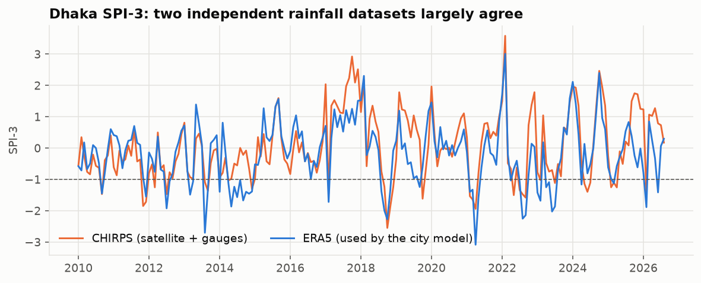

# Is ERA5 rainfall trustworthy? A check against CHIRPS

_Generated by `python -m climrisk districts`._

CHIRPS v2.0 blends satellite estimates with rain-gauge records. Each city's ERA5 series
is compared with the mean of the CHIRPS cells around it, over all months both cover.

| City | ERA5 / CHIRPS total | Monthly corr. | Anomaly corr. | SPI-3 corr. | Drought-month agreement | Cohen's κ |
|---|---:|---:|---:|---:|---:|---:|
| Barishal | 0.87 | 0.90 | 0.66 | 0.72 | 87% | 0.53 |
| Chattogram | 0.87 | 0.89 | 0.58 | 0.61 | 84% | 0.44 |
| Dhaka | 0.90 | 0.89 | 0.65 | 0.71 | 84% | 0.47 |
| Khulna | 0.97 | 0.92 | 0.70 | 0.73 | 85% | 0.49 |
| Mymensingh | 1.06 | 0.88 | 0.57 | 0.66 | 86% | 0.49 |
| Rajshahi | 1.09 | 0.84 | 0.51 | 0.60 | 86% | 0.53 |
| Rangpur | 1.01 | 0.89 | 0.55 | 0.65 | 87% | 0.51 |
| Sylhet | 0.98 | 0.88 | 0.54 | 0.60 | 81% | 0.38 |

How to read it: monthly correlation is inflated by the shared monsoon cycle. Anomaly
and SPI-3 correlation measure agreement on *unusual* months, which is what the
forecasts depend on. Cohen's κ corrects drought agreement for chance (0 = chance,
1 = perfect; 0.4–0.6 is usually called moderate, above 0.6 substantial).

