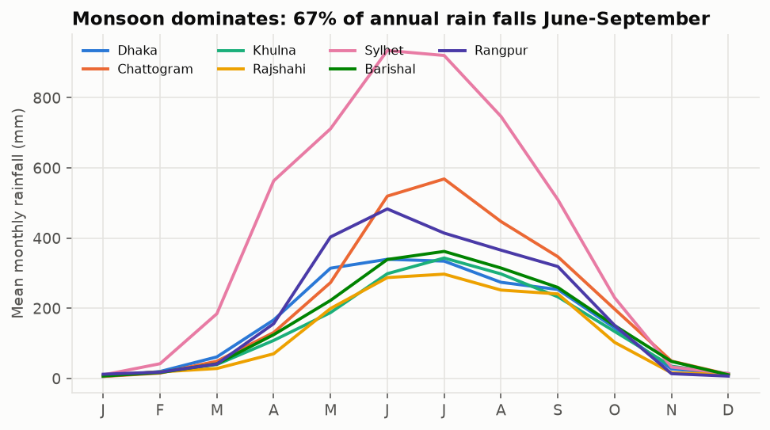
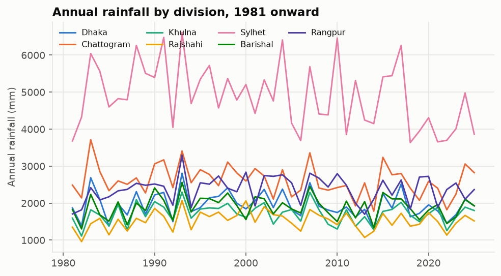
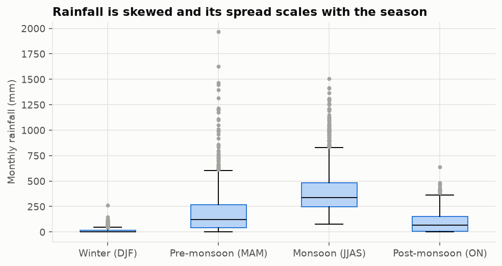
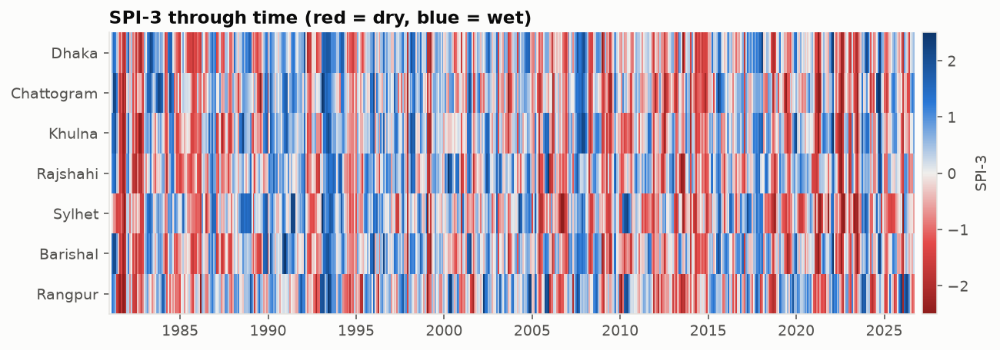
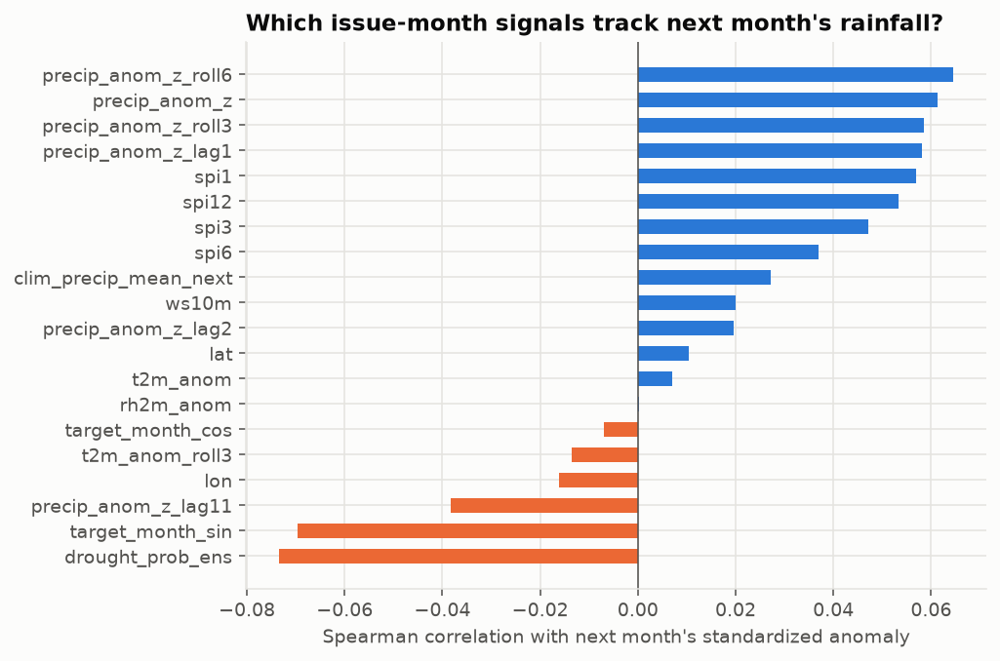

# Exploratory data analysis

_Generated by `python -m climrisk eda`. Do not edit by hand._

- Rows: 3,843 city-months, 1981-01-01 to 2026-09-01, 7 locations.
- Share of annual rainfall falling June-September: 67%.
- Fraction of reference-period months with SPI-3 <= -1.0: 17.2% (theory: ~15.9%).

## Cleaning report

```
rows_in: 3843
missing_in: {'precip_mm': 0, 't2m': 0, 't2m_max': 0, 't2m_min': 0, 'rh2m': 0, 'ws10m': 0}
out_of_range: {'precip_mm': 0, 't2m': 0, 't2m_max': 0, 't2m_min': 0, 'rh2m': 0, 'ws10m': 0}
duplicates_dropped: 0
calendar_months_added: 0
trailing_months_trimmed: 0
covariate_values_interpolated: 0
precip_missing_after_clean: 0
rows_out: 3843
period: ['1981-01', '2026-09']
cities_missing: ['Mymensingh']
```

## Annual rainfall trend (linear, complete years)

| City | Mean annual (mm) | Trend (mm/decade) | p-value |
|---|---:|---:|---:|
| Sylhet | 4,896 | -222 | 0.03 |
| Chattogram | 2,613 | -78 | 0.10 |
| Rangpur | 2,378 | +18 | 0.67 |
| Dhaka | 1,953 | -42 | 0.30 |
| Barishal | 1,895 | -7 | 0.85 |
| Khulna | 1,713 | -6 | 0.84 |
| Rajshahi | 1,530 | +7 | 0.82 |

## Figures






