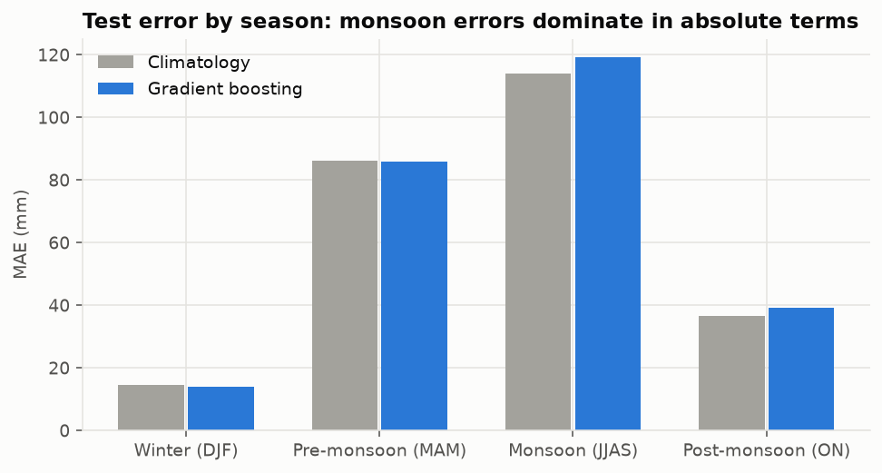
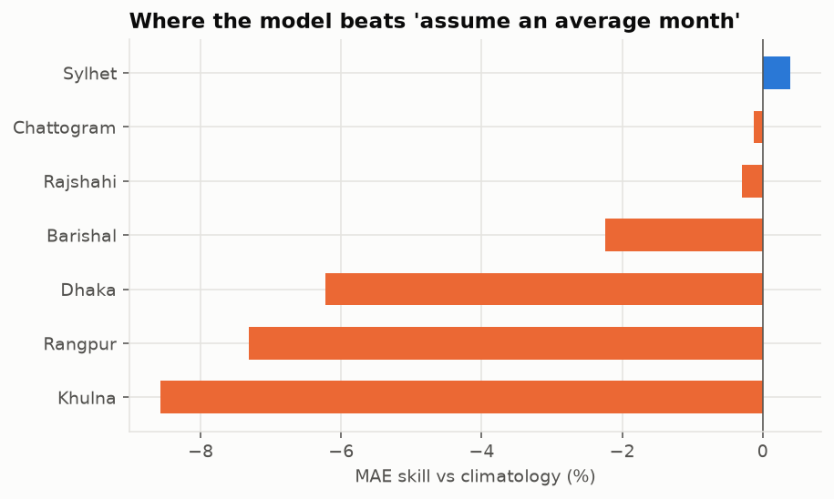
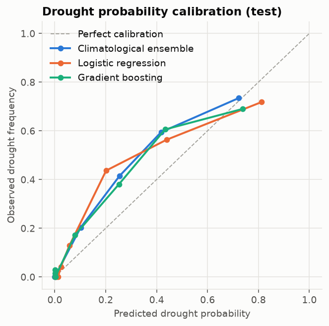
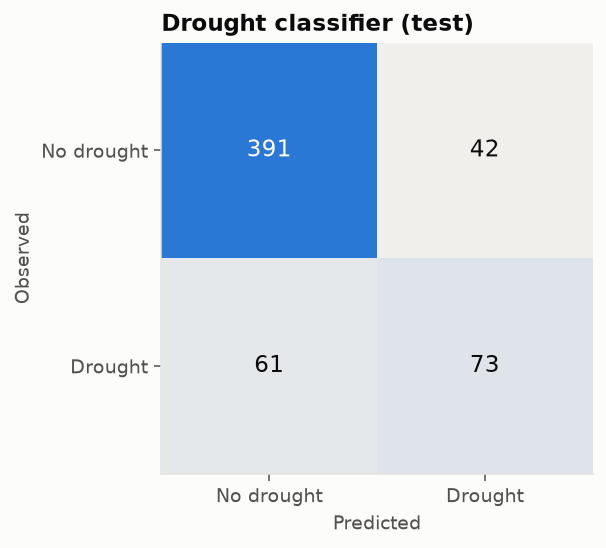
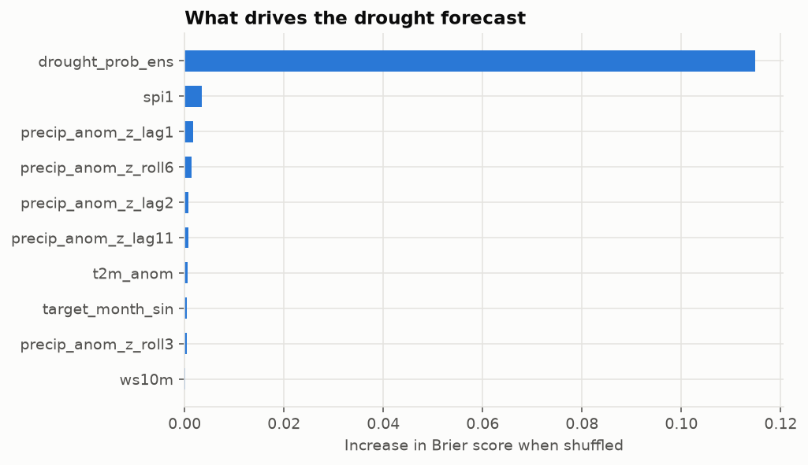

# Test-set evaluation

_Generated by `python -m climrisk evaluate`. Do not edit by hand._

Test period (target months): 2020-01-01 to 2026-09-01, 567 city-months.

## Next-month rainfall anomaly

| Model | MAE (mm) | RMSE (mm) | MAE skill | 95% CI (year bootstrap) | MSE skill |
|---|---:|---:|---:|---:|---:|
| Climatology baseline | 70.8 | 112.0 | +0.0% | - | +0.0% |
| Ridge regression | 70.3 | 111.4 | +0.6% | [-2.5%, +3.9%] | +1.1% |
| Gradient boosting | 72.7 | 116.5 | -2.7% | [-6.5%, +2.2%] | -8.2% |

80% conformal interval: empirical coverage **76.7%**, mean width 199 mm.

| Season | Coverage |
|---|---:|
| Winter (DJF) | 80.0% |
| Pre-monsoon (MAM) | 74.8% |
| Monsoon (JJAS) | 71.4% |
| Post-monsoon (ON) | 86.9% |

## Drought next month (SPI-3 <= -1)

Base rate in test: 23.6%.

| Model | ROC-AUC | PR-AUC | Brier | Brier skill vs base rate | vs ensemble | Threshold | Precision | Recall | F1 |
|---|---:|---:|---:|---:|---:|---:|---:|---:|---:|
| Climatology baseline | 0.500 | 0.236 | 0.186 | +0.0% | -65.0% | 0.50 | 0.00 | 0.00 | 0.00 |
| Climatological ensemble | 0.911 | 0.690 | 0.113 | +39.4% | +0.0% | 0.35 | 0.68 | 0.64 | 0.66 |
| Logistic regression | 0.909 | 0.695 | 0.116 | +37.6% | -3.0% | 0.36 | 0.65 | 0.62 | 0.64 |
| Gradient boosting | 0.897 | 0.672 | 0.115 | +38.0% | -2.2% | 0.41 | 0.63 | 0.54 | 0.59 |

## Error analysis

### By season (gradient boosting vs climatology, MAE in mm)

| Season | Model | Climatology | Skill |
|---|---:|---:|---:|
| Winter (DJF) | 14.0 | 14.6 | +4.0% |
| Pre-monsoon (MAM) | 85.9 | 86.2 | +0.3% |
| Monsoon (JJAS) | 119.1 | 114.0 | -4.5% |
| Post-monsoon (ON) | 39.1 | 36.4 | -7.3% |

### By city

| City | Model | Climatology | Skill |
|---|---:|---:|---:|
| Sylhet | 137.9 | 138.4 | +0.4% |
| Chattogram | 84.4 | 84.3 | -0.1% |
| Rajshahi | 43.3 | 43.2 | -0.3% |
| Barishal | 58.5 | 57.2 | -2.2% |
| Dhaka | 63.0 | 59.3 | -6.2% |
| Rangpur | 65.3 | 60.8 | -7.3% |
| Khulna | 56.5 | 52.0 | -8.6% |

### Ten largest errors

| City | Month | Observed (mm) | Climatology (mm) | Predicted (mm) | Error (mm) |
|---|---|---:|---:|---:|---:|
| Sylhet | 2021-05 | 364 | 756 | 1031 | -667 |
| Chattogram | 2024-08 | 1006 | 429 | 476 | +529 |
| Sylhet | 2024-06 | 1313 | 955 | 812 | +501 |
| Sylhet | 2022-07 | 424 | 949 | 910 | -485 |
| Chattogram | 2026-07 | 985 | 560 | 500 | +485 |
| Sylhet | 2023-05 | 326 | 756 | 771 | -445 |
| Sylhet | 2024-08 | 1200 | 756 | 756 | +444 |
| Sylhet | 2022-08 | 278 | 756 | 717 | -440 |
| Chattogram | 2023-08 | 824 | 429 | 391 | +433 |
| Chattogram | 2022-07 | 182 | 560 | 601 | -419 |

### Permutation importance (top 8)

| Feature | Drought (Brier) | Anomaly (MAE, z units) |
|---|---:|---:|
| `drought_prob_ens` | 0.1148 | 0.0004 |
| `spi1` | 0.0034 | -0.0045 |
| `precip_anom_z_lag1` | 0.0018 | 0.0028 |
| `precip_anom_z_roll6` | 0.0014 | -0.0036 |
| `precip_anom_z_lag2` | 0.0008 | -0.0036 |
| `precip_anom_z_lag11` | 0.0007 | -0.0034 |
| `t2m_anom` | 0.0007 | 0.0007 |
| `target_month_sin` | 0.0005 | -0.0003 |

## Figures

